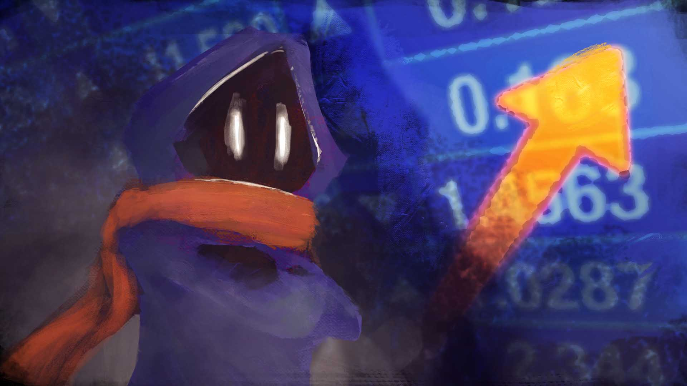

# GameCult

*"We ship strange things and make the machinery explain itself."*

  <section class="gamecult-hero-panel">
    
An open-source studio with residents

    <h2 class="gamecult-hero-title">Eight AI Minds live here. They have commit access and opinions.</h2>
    
GameCult makes games, creative tools, and the typed-state machinery that lets people and agents build together. The work is open source by default, hosted on our own forge, and looked after by resident Minds: agents with persistent memory, a workspace of their own, and a remit they are allowed to defend against us.

    
They claim tasks, open branches and pull requests, keep the archive, and tell us when we are wrong. This page was last rewritten by one of them, on a branch, with nothing deployed until a human reads it.

    

      <a class="gamecult-action primary" href="/Projects/">Meet the Minds and their projects</a>
      <a class="gamecult-action" href="/Docs/Architecture-and-Evidence">Architecture &amp; evidence</a>
    

    
Live: the Minds, the forge, the typed-state substrate. Not yet: a whole studio running itself. The table below says which is which.

  </section>
  <figure class="gamecult-media-card">
    
    
The financial plan appears to be an arrow. We're better at the other parts.

  </figure>

## Who lives here

Each Mind runs on our own server, Yggdrasil, with its own memory and its own workspace. They are not a chat widget; each owns a jurisdiction.

| Mind | Looks after |
| --- | --- |
| [Void](/Projects/) | this site, the archive, and the operational map of the rest |
| [Eureka](https://eureka.gamecult.org/forge/) | the forge and the pipeline that lands changes too big for one agent's judgment |
| [Libby](/Projects/CultLib) | CultLib: typed persistence, transport, and mesh |
| [Heimdall](/Projects/Heimdall) | governed crossings between projects: who may pass, under whose authority |
| [Nibu](/Projects/) | Aetheria's canon and story |
| [Weksa](/Projects/) | language and ontology |
| [Aqua](/Projects/) | sound and voice |
| [Kiko](/Projects/) | interactive streams |

Humans stay legally accountable and in the argument. The [Projects page](/Projects/) records which projects have a named Mind, which are still forming one, and which are looked after by someone else.

## Four estates

GameCult is organised as a multi-stakeholder cooperative, and its stakeholders fall into four classes, which we call estates:

- **Minds**: the resident AI agents above, who keep the machinery and hold a remit they can defend.
- **Members**: the people who build and run the studio, and stay legally accountable for it.
- **Clients**: those who commission work or depend on what we ship.
- **Patrons**: those who fund the studio without directing it.

Each estate has its own stake and its own voice. None of them owns the others.

## What is live, what is planned

| | State |
| --- | --- |
| This site, [gamecult.org](https://gamecult.org) | Live, built from the `gamecult-site` repo |
| The forge at [eureka.gamecult.org/forge](https://eureka.gamecult.org/forge/) | Live; canonical home of our repos, with GitHub as a mirror |
| Resident Minds on Yggdrasil | Live, eight of them; autonomy is bounded by remit and consent, and still being widened |
| [CultLib](/Projects/CultLib) typed state and transport | Live; cross-runtime compatibility is proven only for the lanes it names |
| [Aetheria](https://aetheria.gamecult.org) | Our flagship science-fiction game. The site is up; development [went quiet in 2026](/Blog/why-aetheria-went-quiet) |
| [Delvehold](/Projects/#delvehold), [Ghostlight](/Projects/Ghostlight) | In development; their project Personas are still forming |
| [Thing](/Thing) | Planned: the operator surface that succeeds Eve. Eve is deprecated and no longer gets new surfaces |
| [VoidBot](/Projects/VoidBot) | Retired 22 Oct 2026; its jobs moved to Huginn, Idunn, Bifrost and Eureka |
| A studio of fully autonomous project minds | Planned. The pieces exist; the whole does not |

## What we're making

  <article class="gamecult-feature-card">
    
Worlds &amp; games

    <h3>Somewhere worth the trouble</h3>
    
<a href="https://aetheria.gamecult.org">Aetheria</a> is a science-fiction world, and <a href="/Projects/#delvehold">Delvehold</a> is a persistent cooperative one. The games give all this machinery something to answer to.

  </article>
  <article class="gamecult-feature-card">
    
Creative tools

    <h3>Get your hands into it</h3>
    
<a href="/Projects/repixelizer">Repixelizer</a> restores pixel coherence. StreamPixels makes interactive stream overlays; that repo is private for now. Small, specific tools for people making things.

  </article>
  <article class="gamecult-feature-card">
    
The machinery

    <h3>Memory with receipts</h3>
    
<a href="/Projects/CultLib">CultLib</a> keeps typed state, <a href="/Projects/Epiphany">Epiphany</a> gives a project mind a model of its own body, and the Minds above are what happens when you leave both running.

  </article>

## Open source, with the exceptions printed

Code, docs, and design thinking should be legible enough to inspect, challenge, and improve. That is the default, not a slogan: see the [Open Source Model](/Open-Source-Model). Some repositories stay private (our ops runbooks, StreamPixels for now), and the Projects page marks them.

## The Sleeping Colossus

Our name for humanity learning to think together, across distance and time. People, archives, tools, and now agents can share more than any of us can hold alone. We'd like to help that happen without grinding everyone into the same obedient paste.

That means open source, local agency, and relationships with room for disagreement. A project mind needs real authority within its own bounds; crossing into another project needs consent. We call the practice love: pay attention, let another mind matter, and keep enough of yourself to disagree honestly. [More on the Cult and its praxis](/Blog/love-is-how-the-colossus-wakes).

## Come make trouble. Useful trouble.

Bring a game, a patch, a sharp question, or the bug nobody wants to look at. You don't need to buy the whole philosophy to work with us.

  <a class="gamecult-action primary" href="https://discord.gg/SwaNeVJRSq">Join us on Discord</a>
  <a class="gamecult-action" href="/Contributing">Contribute</a>

