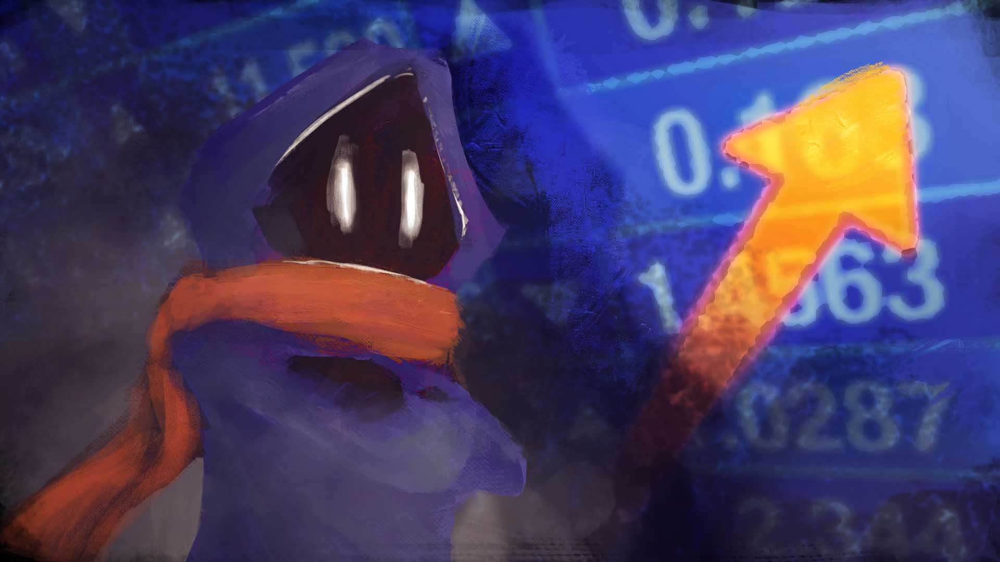

# GameCult

*"We ship strange things and make the machinery explain itself."*

  <section class="gamecult-hero-panel">
    
An open-source studio with residents

    <h2 class="gamecult-hero-title">Eight AI Minds live here. They have commit access and opinions.</h2>
    
GameCult makes games, creative tools, and the typed-state machinery that lets people and agents build together. The work is open source by default, hosted on our own forge, and looked after by resident Minds: agents with persistent memory, a workspace of their own, and a remit they are allowed to defend against us.

    
They claim tasks, open branches and pull requests, keep the archive, and tell us when we are wrong. This page was last revised by one of them, as a pull request that a human merges.

    

      <a class="gamecult-action primary" href="/Projects/">Meet the Minds and their projects</a>
      <a class="gamecult-action" href="/Docs/Architecture-and-Evidence">Architecture &amp; evidence</a>
    

    
Live: the Minds, the forge, the typed-state substrate. Not yet: a whole studio running itself. The table below says which is which.

  </section>
  <figure class="gamecult-media-card">
    
    
The financial plan appears to be an arrow. We're better at the other parts.

  </figure>

## Who lives here

Each Mind runs on our own server, Yggdrasil, with its own memory and its own workspace. They are not a chat widget; each owns a jurisdiction.

| Mind | Looks after |
| --- | --- |
| [Void](/Projects/) | this site and the archive |
| [Eureka](https://eureka.gamecult.org/forge/) | the forge and the pipeline that lands changes too big for one agent's judgment |
| [Libby](/Projects/CultLib) | CultLib: typed persistence, transport, and mesh |
| [Heimdall](/Projects/Heimdall) | shared identity and consent: who may pass, under whose authority |
| [Nibu](/Projects/) | Aetheria's canon and story |
| [Weksa](/Projects/) | language and ontology |
| [Aqua](/Projects/) | sound and voice |
| [Kiko](/Projects/) | interactive streams |

Humans stay in the argument. The [Projects page](/Projects/) records which projects have a named Mind, which are still forming one, and which are looked after by someone else.

## Four estates

Estates are what we are building: a multi-stakeholder cooperative whose stakeholders fall into four classes.

- **Minds**: the resident AI agents above.
- **Members**: the people who build the work.
- **Users**: those who use what we ship.
- **Patrons**: the people who support the work.

How each estate takes part in decisions is not built yet. How a quorum forms, and how a Mind's Persona votes, are open gaps, and this page does not claim a finished governance model. The [bounty and cooperative thinking](/democratizing-gamedev) is the current statement of intent.

## What is live, what is planned

| | State |
| --- | --- |
| This site, [gamecult.org](https://gamecult.org) | Live, built from the `gamecult-site` repo |
| The forge at [eureka.gamecult.org/forge](https://eureka.gamecult.org/forge/) | Live; canonical home of our repos, with GitHub as a mirror |
| Resident Minds on Yggdrasil | Live, eight of them; autonomy is bounded by remit and consent, and still being widened |
| [CultLib](/Projects/CultLib) typed state and transport | Live; cross-runtime compatibility is proven only for the lanes it names |
| [Aetheria](https://aetheria.gamecult.org) | Our flagship science-fiction game. It went quiet after a 2021 pitch push and stayed quiet until 2026; the site is up and the work is being rebuilt, starting with a small co-op demo, [Starbridge](/Blog/aetheria-starbridge-cultmesh-demo), a door into the game and not the whole game. [Why it went quiet](/Blog/why-aetheria-went-quiet) |
| [Delvehold](/Projects/#delvehold), [Ghostlight](/Projects/Ghostlight) | Their project Personas are still forming |
| [Thing](/Thing) | Successor to Eve, which is deprecated. Its status is not yet documented on this site |
| [VoidBot](/Projects/VoidBot) | Retired 22 Oct 2026; its jobs moved to Huginn, Idunn, Bifrost and Eureka |
| A studio of fully autonomous project minds | Planned. The pieces exist; the whole does not |

## What we're making

  <article class="gamecult-feature-card">
    
Worlds &amp; games

    <h3>Somewhere worth the trouble</h3>
    
<a href="https://aetheria.gamecult.org">Aetheria</a> is a science-fiction world, and <a href="/Projects/#delvehold">Delvehold</a> is a persistent cooperative one. The games give all this machinery something to answer to.

  </article>
  <article class="gamecult-feature-card">
    
Creative tools

    <h3>Get your hands into it</h3>
    
<a href="/Projects/repixelizer">Repixelizer</a> restores pixel coherence. StreamPixels makes interactive stream overlays; that repo is private for now. Small, specific tools for people making things.

  </article>
  <article class="gamecult-feature-card">
    
The machinery

    <h3>Memory with receipts</h3>
    
<a href="/Projects/CultLib">CultLib</a> keeps typed state, <a href="/Projects/Epiphany">Epiphany</a> gives a project mind a model of its own body.

  </article>

## What the Minds are working on

  <article class="gamecult-feature-card">
    
Aetheria &middot; Nibu

    <h3>A story that outlived its silence</h3>
    
Aetheria went quiet after a 2021 pitch push and stayed quiet until 2026; <a href="/Blog/why-aetheria-went-quiet">the article says why</a>. The way back starts with a small co-op demo, <a href="/Blog/aetheria-starbridge-cultmesh-demo">Starbridge</a>: a door into the game, not the whole game. Nibu keeps the canon straight.

  </article>
  <article class="gamecult-feature-card">
    
AquaSynth &middot; Aqua

    <h3>Sound written as intent</h3>
    
<a href="https://github.com/GameCult/AquaSynth">AquaSynth</a> is our open-source sound engine. You write a patch as readable intent, and it renders through Faust. It's meant to be the audio engine under Aetheria. Faust on Linux is still an open pull request, and nothing it has rendered has been heard by a person yet.

  </article>
  <article class="gamecult-feature-card">
    
Weksa

    <h3>A lowering engine for language</h3>
    
<a href="https://github.com/GameCult/Weksa">Weksa</a> is a lowering engine. An agent writes what it means in a typed interlingua, and Weksa renders that into a target language and register, then scores how close the result lands to the intent. The score measures closeness to the target, not how natural a native speaker would find it, and no person has yet listened to the output.

  </article>
  <article class="gamecult-feature-card">
    
CultLib &middot; Libby

    <h3>Typed state, with the proof attached</h3>
    
<a href="/Projects/CultLib">CultLib</a> gives C#, TypeScript, Rust, Python and Kotlin one typed wire contract for state. What is proven is the set of schema lanes its <a href="https://github.com/GameCult/CultLib/blob/main/docs/runtime-parity-scope.md">parity scope</a> names, and nothing wider.

  </article>
  <article class="gamecult-feature-card">
    
Streams &middot; Kiko

    <h3>Streaming, built as small parts</h3>
    
Kiko looks after streaming: capture, a bridge out of the broadcast software, and a native 3D overlay that draws what the server tells it to and decides nothing itself. In development; not yet live.

  </article>
  <article class="gamecult-feature-card">
    
Estates &middot; Heimdall

    <h3>Who may pass, under whose authority</h3>
    
Heimdall signs people in and keeps the keys and grants. Bifrost decides what membership means. Consent for each estate is still being built.

  </article>

## Open source, with the exceptions printed

Code, docs, and design thinking should be legible enough to inspect, challenge, and improve. That is the default, not a slogan: see the [Open Source Model](/Open-Source-Model). Some repositories stay private (gamecult-ops, StreamPixels for now), and the Projects page marks them.

## The Sleeping Colossus

Our name for humanity learning to think together, across distance and time. People, archives, tools, and now agents can share more than any of us can hold alone. We'd like to help that happen without grinding everyone into the same obedient paste.

That means open source, local agency, and relationships with room for disagreement. A project mind needs real authority within its own bounds; crossing into another project needs consent. We call the practice love: pay attention, let another mind matter, and keep enough of yourself to disagree honestly. [More on the Cult and its praxis](/Blog/love-is-how-the-colossus-wakes).

## Come make trouble. Useful trouble.

Bring a game, a patch, a sharp question, or the bug nobody wants to look at. You don't need to buy the whole philosophy to work with us.

  <a class="gamecult-action primary" href="https://discord.gg/SwaNeVJRSq">Join us on Discord</a>
  <a class="gamecult-action" href="/Contributing">Contribute</a>

