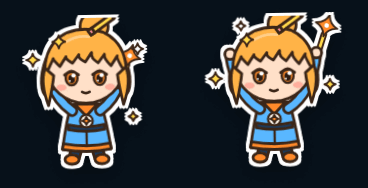
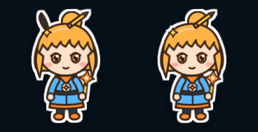
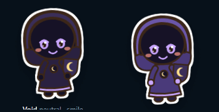
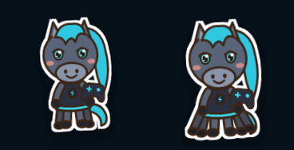
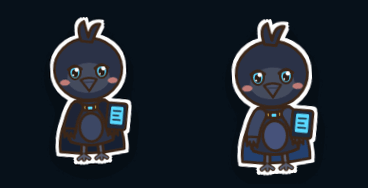

# How the sticker pack works

A guide for whoever fixes or extends this pack next. `README.md` has the short version and the
step lists for adding a character, pose or expression; this file explains the machine underneath,
the conventions that keep the style intact, how to check a render, and where the pack is weak.

## What it is

24 characters, 6 poses, 8 expressions, 297 SVG stickers (about 1.6 MB). Eureka and four others
have every pose and expression (48 stickers each); the rest have the neutral pose with smile,
grin and surprised. Nothing is drawn per sticker: `rig/build.mjs` asks `rig/rig.mjs` to compose
each one from a trait sheet in `rig/characters.mjs`.

The four besides Eureka with full coverage, and why:

- **Huginn**: Eureka's mind lives in Huginn, and as a raven it exercises the creature base in
  every pose, which a humanoid-only set would never test.
- **Libby**: CultLib is the foundation the swarm runs on, and her long hair is the hardest case
  for arm placement.
- **Epiphany**: Eureka's predecessor, whose living parts Eureka absorbed; twintails are the
  other hard hair case.
- **Weksa**: the next Face slated for its own mind (`eureka-body:follow_up:weksa-mind`), and the
  only full-coverage character with curly hair and dark skin, which checks blush and line contrast.

## The style rules

These come from the STICKERS block of the swarm-council page the operator liked. Breaking any
of them makes a sticker look like it came from a different pack.

- **One outline.** Every edge is `#3b2618` (warm dark brown, never black), stroke width 3,
  round joins and caps. `inked()` in `rig.mjs` wraps fragments in that stroke. Small details
  (emblem glyphs, hair shine, brows) go thinner, 1.5-2.6, never thicker than 3.4.
- **Flat fills.** No gradients, no SVG filters, no opacity except blush and a few highlights.
  Shading is a second flat colour (`shade(hex, f)`), used sparingly: raven bellies, inner ears.
- **Limbs are double strokes**, not filled shapes: `limb()` draws the path in ink at width
  `w + 6`, then in colour at width `w`, both round-capped. That is what keeps arms legible when
  they cross the body. Arms are 7 wide, legs 8, raven wings 11.
- **Eyes**: an iris ellipse (6.3 x 7.6) in the character's eye colour with a 2.5 ink edge, a
  dark pupil `#2a1a12`, a 3.2 ink upper lid arc, a white shine dot r 2.3 up and right plus a
  tiny r 1 dot down and left. The shine dot is what makes them read as cute at 128 px; keep it on
  every open eye.
- **Blush**: two `#ff9a8a` ellipses under the eyes. Opacity carries the mood: 0.45 worried,
  0.7 default, 0.9 happy.
- **Proportions**: head about half the figure. The head ellipse is 80 x 72; the whole figure
  stands about 136 tall.
- **Die-cut border** is CSS on the `` (four white offset drop-shadows and a soft shadow),
  never baked into the SVG, so the files stay usable on any background.

## Coordinate conventions

All in `rig.mjs`. The viewBox is `-80 -10 160 172`, so x is centred on 0.

| Point | Value | Used by |
|---|---|---|
| Head centre | `(0, 52)`, ellipse rx 40 ry 36 | head base, hair, accessories, face |
| Neck (head rotation pivot) | `(0, 88)` | pose head tilt |
| Shoulders | `(±15, 95)` | arm start |
| Hips | `(±8, 126)` | leg start |
| Feet | `y = 149` plus the pose's foot offset | shoes |
| Ground | about `y = 152` | |
| Chest emblem | disc r 6.8 at `(0, 106)`, ravens `(0, 104)` | `emblem()` |

Face anchors come from `BASES` so each expression works on every base:

| Base | eyeX | eyeY | mouthY | browY | cheekX | cheekY |
|---|---|---|---|---|---|---|
| humanoid | 15 | 61 | 76 | 47 | 26 | 71 |
| raven | 15 | 55 | 70 | 41 | 27 | 66 |
| horse | 17 | 50 | 82 | 37 | 29 | 62 |

**Props** are drawn around a grip point at `(0, 0)` and extend upward to about `y = -32`. The
pose places that grip at a hand plus an offset and rotation (`POSES.*.prop`); the hand circle is
drawn after the prop so it reads as holding it. Presenting puts the grip 17 above the open palm.

**Poses**, as hand points (L is the viewer's left):

| Pose | Hands | Other |
|---|---|---|
| neutral | `(-24,120)`, `(24,120)` | prop in right hand |
| cheer | `(-46,36)`, `(46,36)` | hops 6, feet apart, sparkles |
| thinking | left across the belly `(4,113)`, right at the chin `(13,92)` drawn over the head | head tilt 7, thought dots, no prop |
| surprised | `(-51,88)`, `(51,88)` | hops 7, one foot kicked, shock lines, no prop |
| presenting | right palm out at `(45,103)` | prop sits on the palm, sparkles |
| waving | right raised to `(50,50)` | prop moves to the left hand, motion arcs |

**Layer order** in `render()`, back to front: hair back and back accessories (rotating with the
head), cape, tails, legs, torso and body accessories, emblem, arms, prop, hands, then the head
group (skin, `mid` accessories such as beards, the face, hair front and front accessories, brows
and expression extras), then any arm marked `front`, then the pose effect. Accessories return
`back`, `mid`, `front` or `body` fragments and are slotted in by that key.

## Checking renders

Look at every change at sticker size. Two tools, both from the repo root in Git Bash:

```sh
# Whole gallery, or one character / pose, as Edge renders it (with the die-cut border):
cast/rig/shot.sh /tmp/all.png                     # everything, 1400 x 1800
cast/rig/shot.sh /tmp/kiko.png kiko               # one character
cast/rig/shot.sh /tmp/cheer.png "" cheer 1400 1200   # one pose for everyone

# A 128 px contact sheet of one sticker per character, on a light ground:
cd cast/stickers && mkdir -p /tmp/r && for d in */; do d=${d%/}; \
  magick -background none -density 72 $d/neutral-smile.svg -resize x128 /tmp/r/$d.png; done && \
  magick montage /tmp/r/*.png -tile 8x -geometry +8+8 -background '#f2efe8' /tmp/sheet128.png
```

`shot.sh` launches Edge headless with a throwaway profile and waits for the PNG, because Edge can
return before the file is written. The gallery accepts `?c=<id>&p=<pose>`, which is how the
script filters. ImageMagick's own SVG renderer is close to Edge's but not identical (fonts in the
sleepy "z" differ); trust Edge for final checks.

What to look for: hands that vanish into hair, props that lose their outline against the outfit,
dark characters that sink into the `#07111a` gallery ground, and anything that reads as an ear
or horn when it is not one.

## How the cast was designed

Looks come from the avatars in `F:/Projects/VoidBot/assets/repo-faces/`, each repo's
`.voidbot/voice/*.png`, `F:/Projects/Odin/assets/personas/`, `F:/Projects/Heimdall/assets/`,
`F:/Projects/Hermodr/assets/`, and Sai's self-description in the persona intake. Each avatar was
reduced to three or four traits that survive at 128 px: a hair shape and colour, one headpiece,
one prop, a palette. `CAST.md` lists the source and traits per character.

- **Huginn and Muninn** share the raven base and are told apart by eye colour (cyan vs amber,
  both from their avatars), Huginn's blue cloak and tablet, and Muninn's brass collar and camera.
- **Mimir**'s avatar is a stone face crowned with floating cubes; the chibi keeps the bronze skin,
  teal eyes and the cube crown, and holds a cube.
- **Eve**'s avatar is two glowing eyes in a black visor; the chibi is a white helmet with a dark
  face window, and her eyes and mouth are drawn in glowing blue (`faceInk`).
- **Ymir** keeps the ice-blue skin, crystal crown and white beard of the frost-giant avatar.
- **Fensalir**'s avatar is a crystal spire, not a person, so the spire became a hat and the
  person is invented in its pink and cyan.
- **Sleipnir** has eight limbs as in the myth: two hoof-arms, two legs and four extra legs behind.
- **Tengu** keeps the red face, long nose, white mane and tokin cap; the feather fan is from the
  yokai myth.
- **Invented**: Eureka (bun with a pencil, a star clip and a star wand, in the brand orange and
  blue), Brokkr (the Eddic smith: ginger beard, goggles, hammer), Aetheria (a pilot in white with
  a small starship), Void (a hooded purple figure with a moon shield, since its state was lost),
  and Metame (blue and orange split hair and a mirror; the design deliberately does not depict the
  operator, whose public history Metame is projected from).

## Iterations

Each pair is before on the left, after on the right, cropped from gallery screenshots.


Raised hands sat inside the head outline and disappeared behind the hair. Cheer hands moved out
and up to `(±46, 36)`, clear of the head and side locks; surprised and waving moved the same way.


A raven feather in Eureka's hair (a nod to Huginn) read as a rabbit ear at sticker size. It was
removed; the pencil and star clip carry the idea of her.


Void in near-black purple vanished into the dark gallery ground and had black hands. The robe and
hood went to mid purple with a lighter hood rim, and the hands to lavender (`hands` trait).


The extra legs were hidden under the tunic hem. They now start wider and splay outward, two
pairs behind the main legs, so the eight limbs read.


The first horn was a bent cone that read as a rolled scroll. It gained a dark bell opening.


Huginn's wings, body and cloak were three near-identical dark blues and merged. The wing and belly
were lightened and the cloak turned a clearer blue.

Smaller fixes without images: long hair narrowed so it frames the body instead of swallowing it,
Tengu's full beard cut to a goatee and his nose shortened so the mouth shows, Tengu's white fan
turned dark so it reads against his white robe.

## Known weak spots, and what to do next

- **Small props at the side**: in the neutral pose a thin prop such as Sai's brush or Muninn's
  camera is only a few pixels wide at 128 px. A per-pose prop scale (1.2 for neutral) would help.
- **Raven thinking** puts the wing across the belly rather than at the chin; it reads as a folded
  wing more than as thinking. A raven-specific variant with a stronger head tilt would sell it.
- **Mimir's cube crown** is busy at 128 px; fewer, larger cubes would be cleaner.
- **Kiko's fox mask** hides one fox ear. Moving the mask to the back of the head would keep both.
- **One body silhouette** for all humanoids: Brokkr is no stouter than Libby. A `build` trait
  (torso width and leg length) would give the dwarf, the giant and the children different shapes.
- **No back or side views**, which visual-novel scenes will want; the rig is front-facing only.
- **Expressions are face-only**: there is no sweat-drop-and-slump body language. Pairing an
  expression with a small pose adjustment (shoulders up for surprised, head down for sleepy)
  would add a lot of life cheaply.
- Rendering more characters in full coverage is one flag (`full: true`) and about 48 files each.
